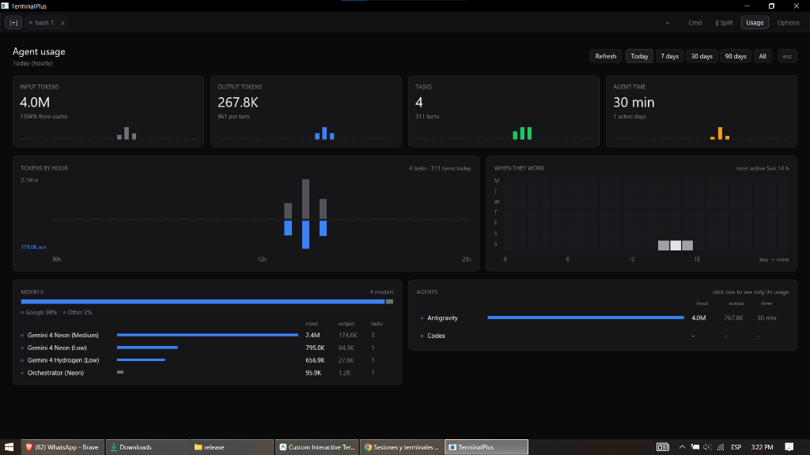
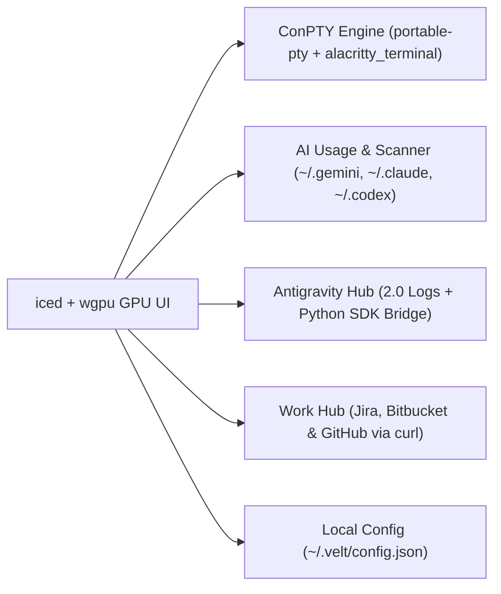

<div align="center">

```text
██╗   ██╗███████╗██╗  ████████╗
██║   ██║██╔════╝██║  ╚══██╔══╝
██║   ██║█████╗  ██║     ██║
╚██╗ ██╔╝██╔══╝  ██║     ██║
 ╚████╔╝ ███████╗███████╗██║
  ╚═══╝  ╚══════╝╚══════╝╚═╝
```

### Native GPU-Accelerated Terminal for Developers, AI Agents & Atlassian/Git Workflows

[](https://www.rust-lang.org/)
[](https://iced.rs/)
[](https://learn.microsoft.com/en-us/windows/console/creating-a-pseudoconsole-session)
[](#privacy--local-first)
[](LICENSE)

*No Electron. No WebView. No telemetry. Built in pure Rust.*

</div>

---

## Why Velt?

Modern AI-assisted development deserves a terminal that feels instantaneous, respects your RAM, and unifies your **shells**, **AI agents**, and **Jira / Bitbucket / GitHub** workflow in one native GPU window.


*Velt's `Agent usage` dashboard rendering real local AI logs on GPU.*

### Layout overview

```text
+-----------------------------------------------------------------------------------+
| [=]  * bash 1   * wsl 2                         +  Cmd  || Split  AGY Work Usage Options |
+------------------+----------------------------------------------------------------+
| + New session ^T |                                                                |
| Search agents  / |  ~/Projects/my-app                                             |
| [All] [Working]  |  $ cargo test                                                  |
|                  |                                                                |
| my-app           |                                                                |
| * bash 1     2m  |                                                                |
|   Waiting        |                                                                |
|                  |                                                                |
| AI Agents  2 ok  |                                                                |
| [AGY] [Codex]    |  [bash] my-app  git:main  [Rust]                118x34 Ctrl+K  |
+------------------+----------------------------------------------------------------+
```

---

## Architecture



---

## Key Features

### 1. Native Terminal Core
- **True Windows ConPTY** via `portable-pty` + `alacritty_terminal` ANSI/256-color/TrueColor emulation.
- **Multi-shell support:** **Git Bash**, **WSL**, **Windows PowerShell**, **PowerShell 7**, **CMD**, or any custom executable (`Options` -> `Ctrl+,`).
- **Flexible Split Panes:** Side-by-side (`Horizontal`) or Top/Bottom (`Vertical`) splits via `|| Split` or `Ctrl+K`.
- **Smart Bottom HUD:** Displays active shell, project folder, live Git branch (`.git/HEAD`), detected tech stack (`Rust`, `Laravel`, `PHP`, `TS`, `Node`, `Python`, `Go`), and grid dimensions (`cols x rows`).
- **Mouse Selection & Clipboard:** Drag to select, double-click to select word, `Ctrl+Shift+C` to copy, `Ctrl+Shift+V` to paste, and smart right-click (copies when text is selected, pastes otherwise).
- **In-Terminal Search & Clickable URLs:** Press `Ctrl+F` to highlight matches with next/prev navigation, and `Ctrl+Click` any `http://` or `https://` URL to open it directly in your browser.
- **Themes & Crisp Fonts:** Auto-detects `Cascadia Mono`, `JetBrains Mono`, or `Consolas` with **Midterm Dark**, **Tokyo Night**, and **Catppuccin Mocha** themes.
- **Command Palette (`Ctrl+K`):** Quick-launch shells, toggle split layouts, run Git snippets, or jump to any hub.

### 2. AI Agent Scanner & `Agent usage` Dashboard (`Ctrl+U`)
- **Zero-telemetry local scanner** detecting **Antigravity**, **Codex**, **Claude Code**, **Gemini CLI**, **opencode**, **Ollama**, and **Grok CLI**.
- **GPU-rendered analytics** across `Today (hourly)`, `7 days`, `30 days`, `90 days`, and `All`:
  - **KPI sparklines:** Input Tokens (with cache share), Output Tokens, Tasks, and Agent Time.
  - **Mirrored Token Chart:** Input vs. Output tokens by hour (`00h–23h`) or by day.
  - **Activity Heatmap:** `WHEN THEY WORK` 7x24 matrix highlighting peak hours.
  - **Model & Agent Breakdown:** Per-model token bars (including per-turn Orchestrator model tracking) and clickable agent filtering.

### 3. Antigravity Hub (`AGY` / `Ctrl+Shift+A`)
- **2.0 Conversations Explorer:** Inspects local Antigravity 2.0 sessions (`~/.gemini/antigravity/brain`), showing live/saved status, models, turns, thinking previews, tool chips, and a 1-click **`Open Terminal in Project`** launcher.
- **Native Chat (SDK):** Clean native chat panel powered by the official `google-antigravity` Python SDK, with automatic Python/SDK detection and 1-click terminal installation.

### 4. Work Hub — Jira, Bitbucket & GitHub (`Ctrl+J`)
- **Auto-detects Git remotes** (`origin` HTTPS/SSH) for GitHub and Bitbucket repositories.
- **Jira Cloud:** View unresolved issues assigned to you (`All`, `To Do`, `In Progress`, `Done`) and click **`Start Branch`** to run `git checkout -b feat/KEY-...` in your active terminal.
- **Bitbucket & GitHub:** Browse open Pull Requests and click **`Checkout PR`** to fetch & switch branches directly.
- **Flexible Connections:** Supports 1-click import from **`gh auth token`** and **Windows Git Credential Manager** (`git credential fill`), **Browser OAuth 2.0** callbacks, or direct API tokens.

---

## Keyboard Shortcuts

| Shortcut | Action |
| :--- | :--- |
| `Ctrl+T` | Open a new terminal session (default shell) |
| `Ctrl+W` | Close / archive active tab (when > 1 tab open) |
| `Ctrl+K` | Open **Command Palette** |
| `Ctrl+\` or `Ctrl+Shift+D` | Toggle split pane |
| `Ctrl+B` | Toggle left sidebar |
| `Ctrl+U` | Toggle **Agent usage** analytics |
| `Ctrl+J` | Toggle **Work Hub** (Jira / Bitbucket / GitHub) |
| `Ctrl+Shift+A` | Toggle **Antigravity Hub** |
| `Ctrl+,` | Open **Options & Themes** |
| `Ctrl+Shift+C` / `Ctrl+Shift+V` | Copy selection / Paste clipboard |
| `Ctrl+F` | Find in visible terminal output (`Enter`/`>` next, `<` prev, `Esc` close) |
| `Ctrl+Click` | Open URL under cursor in default browser |
| `Esc` | Close active overlay / search bar |

---

## Benchmarks

Measured locally on **Windows** (`release` build, single `bash` tab at idle):

- **Test machine:** `Intel(R) Core(TM) i3-10110U CPU @ 2.10GHz` (4 logical cores) · `Intel(R) UHD Graphics`
- **Standalone binary size:** **10.03 MB** (`10,518,016` bytes)

| Backend | Cold Start (to window) | Idle Working Set RAM | Idle Private RAM | Idle CPU (3s window) |
| :--- | :--- | :--- | :--- | :--- |
| **Vulkan GPU** *(default)* | `221 ms` | `111.3 MB` | `70.0 MB` | `1.82%` |
| **tiny-skia** *(software)* | `81 ms` | `40.5 MB` | `25.8 MB` | `1.17%` |

> **Methodology:** Cold start measures `Start-Process` until a non-zero `MainWindowHandle` appears; RAM and CPU are sampled via PowerShell `Get-Process` (`WorkingSet64`, `PrivateMemorySize64`, and `TotalProcessorTime` delta over a 3-second idle window). Dedicated GPU VRAM is not yet measured here and is planned for the `v0.5` built-in benchmark suite.

---

## Build from Source (Windows)

### Prerequisites
- [Rust](https://rustup.rs/) (`stable`)
- On `x86_64-pc-windows-gnu`, a MinGW-w64 toolchain (`gcc` / `dlltool`, e.g. `winget install BrechtSanders.WinLibs.POSIX.UCRT`) or standard MSVC Build Tools for `x86_64-pc-windows-msvc`.

### Run Tests & Release Build
```powershell
git clone https://github.com/jregnaultt/velt.git
cd velt

# Run unit & ConPTY integration tests
cargo test -- --nocapture

# Build optimized standalone binary (~10 MB)
cargo build --release
```

Run the generated binary:
```powershell
.\target\release\velt.exe
```

> **Tip for older GPUs without Vulkan drivers:** Launch once with software rendering:
> ```powershell
> $env:ICED_BACKEND = "tiny-skia"; .\target\release\velt.exe
> ```

---

## Privacy & Local-First

- **Zero telemetry:** Velt never phones home or tracks usage.
- **Local storage only:** Preferences and integration tokens are stored locally in `~/.velt/config.json` (automatically migrated from `~/.terminalplus/config.json` if upgrading).
- **Direct API calls:** Work Hub communicates directly with Atlassian, Bitbucket, and GitHub APIs via `curl.exe` using stdin config so credentials never leak into process arguments.

---

## Roadmap

### Completed (`v0.1`)
- [x] Native GPU terminal with ConPTY, splits, themes & mouse selection
- [x] Real-time AI agent scanner & `Agent usage` GPU charts (`Today` hourly + multi-day)
- [x] `Antigravity Hub` (2.0 live log explorer + Python SDK chat)
- [x] `Work Hub` (Jira Cloud + Bitbucket Cloud + GitHub)
- [x] In-terminal search (`Ctrl+F`) & clickable URLs (`Ctrl+Click`)

### `v0.2` — Terminal Power
- [ ] Scrollback-wide search & regex search mode
- [ ] Tab drag-to-reorder & inline tab renaming
- [ ] User-configurable keybindings (`~/.velt/config.json`)
- [ ] Font ligatures support & Sixel / Kitty image protocol
- [ ] Automatic session & split layout restore on restart

### `v0.3` — AI & Agent Superpowers
- [ ] Inline *"Explain this error"* action via Antigravity SDK
- [ ] Live per-tab agent detection (Claude Code / Codex / Gemini CLI running inside a pane)
- [ ] Cost estimation per model & CSV/JSON usage export
- [ ] Live streaming token ticker in the bottom HUD

### `v0.4` — Work & Team Hub
- [ ] Jira issue transitions & comment posting directly from Velt
- [ ] Built-in PR diff viewer & CI/pipeline status badges
- [ ] Bitbucket & GitHub notifications feed + branch-to-ticket auto-linking

### `v0.5` — Performance & Benchmarks
- [ ] Built-in `velt --bench` suite (RAM, CPU, GPU VRAM, and frame time)
- [ ] PTY throughput benchmark (`cat` large stream MB/s) & input latency profiler
- [ ] Automated CI benchmark regression tracking & comparison table (vs. Windows Terminal, Warp, WezTerm, Alacritty)

### `v0.6` — Cross-Platform & Remote
- [ ] Native Linux & macOS builds
- [ ] Signed Windows installer (`.msi` / `winget`) & auto-updater
- [ ] Remote Work PCs sync *(Coming soon)*

---

<div align="center">
Built as a personal craft project by <a href="https://github.com/jregnaultt">Javier Regnault</a> · MIT License
</div>
